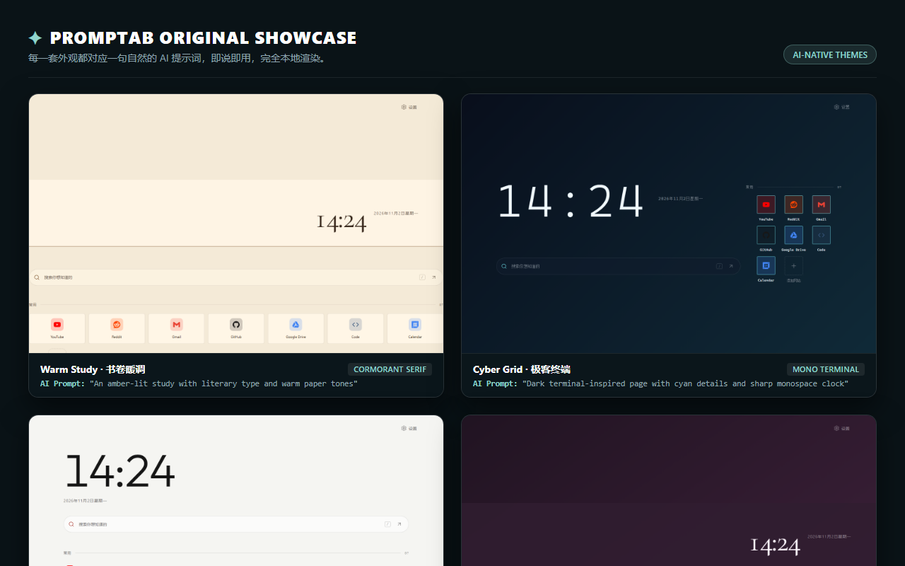

# Promptab

English | [简体中文](README.zh-CN.md) · [Official Website](https://zanderh-code.github.io/promptab/) · [Theme Gallery](https://zanderh-code.github.io/promptab/gallery/index.json) · [Privacy Policy](https://zanderh-code.github.io/promptab/privacy/)

**Describe it. Paste it. Done.**

Your new tab, designed by your AI. Bring any AI you already use—ChatGPT, Claude, Kimi, DeepSeek, and more. No Promptab account, API key, or AI credits required. Preview changes, undo anytime, and keep your data on this device.


## ✨ AI-Native Themes & Original Layouts

Promptab transforms natural-language prompts into custom themes, layouts, typography, and color palettes—all rendered 100% locally in your browser.



| Theme | Style & Typography | Example AI Prompt |
| --- | --- | --- |
| **Warm Study** | Cormorant Serif · Amber Paper | `"An amber-lit study with literary type, warm paper tones, and minimal links"` |
| **Cyber Grid** | Mono Terminal · Cyan Glow | `"Dark terminal-inspired page with cyan details and sharp monospace clock"` |
| **Swiss Minimal** | Modern Sans · Crisp Alignment | `"Swiss graphic design: high-contrast layout, crisp borders and modern sans"` |
| **Plum Night** | Soft Glow · Deep Purple | `"Quiet midnight desk: deep plum palette, soft glow on clock, and rounded cards"` |

## Features

- Browse the online theme gallery, copy example prompts, and preview themes before applying them.

- Clock, date, search, greetings and other configurable widgets; layout templates and editable widget areas
- Website shortcuts with groups, drag-and-drop sorting, browser bookmark import, and automatic, image or text icons
- Preset themes, colors, fonts, shapes, custom CSS and local wallpaper
- Multiple profiles, undo history, JSON backups, and nightTab import
- AI workbench for creating, validating, previewing and sharing theme packs with your own AI assistant
- English and Simplified Chinese interface

Back up your setup via **Settings → Data → Export backup** and keep the file outside the browser before uninstalling. Import validates the backup before replacing your setup.

## Try the Firefox build

Build the Firefox version from the project directory:

```bash
npm run build:firefox
```

Open `about:debugging#/runtime/this-firefox`, choose **Load Temporary Add-on**, and select `dist-firefox/manifest.json`. Temporary add-ons are removed when Firefox closes. The Firefox package is not available from AMO yet; see [Firefox build and AMO notes](docs/firefox.md).

## Install in Edge

Install Node.js 22 and npm, then run these commands in the project directory:

```bash
npm install
npm run build
```

Open `edge://extensions`, enable Developer mode, select **Load unpacked**, and choose the project's `dist` folder. Confirm the new tab change if the browser asks. Rebuild and reload the extension after updating the source.

## Make a theme with AI in five minutes

1. Open a new tab and choose **Settings → AI**. Optionally describe the look you want and enable **Include my current theme and CSS (no bookmarks)**.
2. Select **Copy prompt pack** and paste it into your own AI assistant. The extension does not contact the assistant for you; anything you send is subject to that service's terms. The optional current configuration excludes bookmarks, but review your request and custom CSS before sharing.
3. Paste the assistant's entire reply into **The AI's reply**. You can also open a `.json`, `.css` or `.md` file. If multiple code blocks are found, choose one.
4. Review corrections and warnings. If there are errors, use **Copy errors for the AI**, send them back, and paste the corrected reply. Select the parts you want, then choose **Preview** and **Apply**. A preview is not saved until applied; you can undo an applied change.

Example conversation (the prompt pack supplies the format and rules):

> **You:** Create a warm paper-like page with a serif clock and a muted terracotta accent. Keep my layout and bookmarks.
>
> **AI:** Here is a light theme with warm paper colors.

```json
{
  "kind": "mnt.theme-pack",
  "packVersion": 2,
  "theme": {
    "mode": "light",
    "colorLight": {
      "bg": "#f3ecdf",
      "surface": "#faf5ea",
      "text": "#2f2a24",
      "accent": "#9a4a28"
    },
    "font": { "display": "cormorant", "ui": "system" },
    "radius": 6
  }
}
```

Copy the complete reply, including the JSON code block, into the workbench. This example changes the theme only. For more examples and the field reference, see [AI documentation](docs/ai/llms.txt) and [theme pack examples](docs/ai/examples/).

## Development

```bash
npm install
```

```bash
npm run dev
```

```bash
npm run test -- --run
```

```bash
npm run build
```

## Browser checks

After building, start the production preview:

```bash
npm run preview
```

In another terminal, install Chromium once and run the tests:

```bash
npx playwright install chromium
```

```bash
npm run test:e2e
```

The tests freeze the clock and compare four viewport baselines stored in `e2e/baselines/`. They also cover backup round trips, rejected/cancelled imports, language switching and themed dropdowns. Baselines were generated with Chromium on Windows; font rendering can differ on other platforms.

## Permissions and data

The extension requests `storage`, `unlimitedStorage`, and `favicon` permissions. `unlimitedStorage` supports local profiles and history without Chrome's standard local storage quota. `favicon` reads website icons cached by the browser. If the cache is unavailable, it requests the site's `/favicon.ico`, so the website may receive a connection request. Importing browser bookmarks requests the optional `bookmarks` permission. Settings are stored locally in the browser, and uninstalling the extension may delete them.

Read the [privacy policy](https://zanderh-code.github.io/promptab/privacy/).

## License

Minimal New Tab is released under the [MIT License](LICENSE). Third-party runtime dependencies retain their own licenses; see [third-party notices](licenses/THIRD_PARTY_NOTICES.md).
