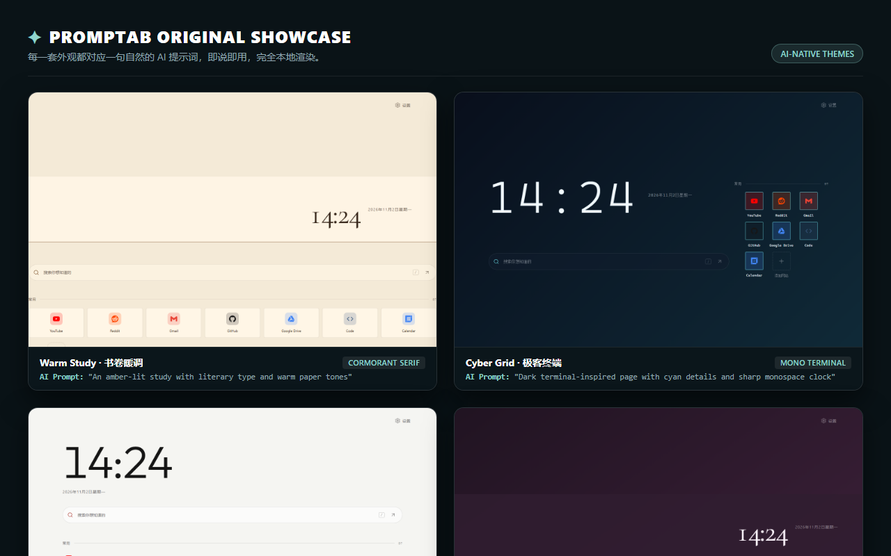

[](https://github.com/ZanderH-code/promptab/actions/workflows/ci.yml)

# Promptab

[English](README.md) | 简体中文 · [官方主页](https://zanderh-code.github.io/promptab/) · [主题画廊](https://zanderh-code.github.io/promptab/gallery/) · [使用文档](https://zanderh-code.github.io/promptab/docs/) · [画廊 JSON](https://zanderh-code.github.io/promptab/gallery/index.json) · [隐私政策](https://zanderh-code.github.io/promptab/privacy/)

**想要什么样，就跟 AI 说什么样。**

用你已经在用的任何 AI（ChatGPT、Claude、Kimi、DeepSeek 等）设计新标签页。不需要 Promptab 账号、API key 或额外 AI 额度。修改可以预览、随时撤销，数据只保存在这台设备。


## ✨ 原创主题与布局展示

Promptab 将自然的语言描述直接转化为浏览器主页的布局排版、字体与色彩体系，完全在浏览器本地渲染。



| 主题名称 | 风格与字体 | 示例 AI 提示词 |
| --- | --- | --- |
| **Warm Study · 书卷暖调** | Cormorant 典雅衬线 · 暖纸色 | `“琥珀灯光下的书房，文字带有书卷气，暖纸色背景衬托常用网站”` |
| **Cyber Grid · 极客终端** | 等宽代码风 · 青色荧光高亮 | `“深色终端风格页面，以青色点缀、利落的时钟和紧凑书签网格为主”` |
| **Swiss Minimal · 瑞士极简** | 现代无衬线体 · 利落线条对齐 | `“瑞士平面设计风格：黑白红高对比排版、克制留白与利落边框”` |
| **Plum Night · 静谧梅紫** | 深邃紫调 · 柔和时钟光晕 | `“安静的梅紫夜色，搭配优雅字体、柔和圆角和居中的书签”` |

## 功能

- 浏览在线主题画廊，复制示例提示，在应用前预览主题。

- 时钟、日期、搜索、问候语等可配置组件，提供布局模板和可编辑的组件区域
- 网站快捷方式支持分组、拖拽排序、浏览器书签导入，以及自动识别、图片或文字图标
- 预设主题、颜色、字体、形状、自定义 CSS 和本地壁纸
- 多个配置档、撤销历史、JSON 备份和 nightTab 导入
- 使用自己的 AI 助手，通过 AI 工作台创建、校验、预览和分享主题包
- 中文和英文界面

在「设置 → 数据 → 导出备份」保存配置，并在卸载前将备份保存在浏览器之外。导入时会先校验备份，再覆盖当前配置。

## 使用网页版

在浏览器中打开 [Promptab 网页版](https://zanderh-code.github.io/promptab/app/)。在 iPhone 或 iPad 上使用 Safari 打开，点击**分享**，再选择**添加到主屏幕**。在 Android 上使用 Chrome 打开，点击菜单，再选择**安装应用**或**添加到主屏幕**。

网页版的设置与浏览器扩展分开保存。如需在两者之间迁移配置，请在「设置 → 数据」中导出备份，再在另一个版本中导入。浏览器同步和浏览器书签导入依赖扩展 API，网页版不支持。网页版存储和网络行为详见[隐私政策](https://zanderh-code.github.io/promptab/privacy/)。

## 试用 Firefox 版本

在项目目录构建 Firefox 版本：

```bash
npm run build:firefox
```

打开 `about:debugging#/runtime/this-firefox`，选择「此 Firefox」，点击「临时载入附加组件」，然后选择 `dist-firefox/manifest.json`。Firefox 关闭后会移除临时扩展。Firefox 版本目前尚未上架 AMO；详见 [Firefox 构建与 AMO 说明](docs/firefox.md)。

## 在 Edge 中安装

安装 Node.js 22 和 npm，然后在项目目录运行：

```bash
npm install
npm run build
```

打开 `edge://extensions`，启用开发人员模式，选择「加载解压缩的扩展」，然后选择项目的 `dist` 文件夹。如果浏览器询问，请确认新标签页更改。更新源代码后，重新构建并重新加载扩展。

## 五分钟用 AI 制作主题

1. 打开新标签页，进入「设置 → AI」。可以先描述想要的风格，也可以开启「附带我当前的主题和 CSS（不含书签）」。
2. 点击「复制提示包」，粘贴给你自己的 AI 助手。扩展不会替你联系 AI；你发送的内容受所用服务条款约束。可选的当前配置不含书签，但分享前请检查你的需求和自定义 CSS。
3. 把 AI 的整段回复粘贴到「AI 的回复」，也可以选择 `.json`、`.css` 或 `.md` 文件。如果识别出多个代码块，选择其中一个。
4. 查看自动修正和提醒。如果有错误，点击「复制错误给 AI」，发回给助手，再粘贴修正后的回复。选择要应用的部分，点击「预览」和「应用」。预览在应用前不会保存；应用后可以撤销。

对话示例（提示包会提供格式和规则）：

> **你：** 做一个温暖的纸张风格页面，使用衬线时钟和柔和的陶土色强调色。保留我的布局和书签。
>
> **AI：** 这是一个使用暖纸色的浅色主题。

```json
{
  "kind": "mnt.theme-pack",
  "packVersion": 2,
  "theme": {
    "mode": "light",
    "colorLight": {
      "bg": "#f3ecdf",
      "surface": "#faf5ea",
      "text": "#2f2a24",
      "accent": "#9a4a28"
    },
    "font": { "display": "cormorant", "ui": "system" },
    "radius": 6
  }
}
```

将包含 JSON 代码块的完整回复复制到工作台。此示例只修改主题。更多示例和字段参考见 [AI 文档](docs/ai/llms.txt)和[主题包示例](docs/ai/examples/)。

## 开发

```bash
npm install
```

```bash
npm run dev
```

```bash
npm run test -- --run
```

```bash
npm run build
```

## 浏览器检查

构建后启动生产预览：

```bash
npm run preview
```

在另一个终端首次安装 Chromium，然后执行测试：

```bash
npx playwright install chromium
```

```bash
npm run test:e2e
```

测试固定时钟并比对 `e2e/baselines/` 中四种窗口尺寸的截图，也检查备份往返、无效及取消导入、语言切换和下拉菜单主题色。基线在 Windows Chromium 下生成；其他平台的字体渲染可能不同。

## 权限与数据

扩展申请 `storage`、`unlimitedStorage` 和 `favicon` 权限。`unlimitedStorage` 供本地配置档和历史使用，避免触及 Chrome 的标准本地存储配额；`favicon` 用于读取浏览器缓存的网站图标；缓存不可用时会向网站请求其 `/favicon.ico`，因此网站可能收到连接请求。导入浏览器书签时会请求可选的 `bookmarks` 权限。设置保存在浏览器本地存储中，卸载扩展可能删除其本地数据。

阅读[隐私政策](https://zanderh-code.github.io/promptab/privacy/)。

## 许可证

Minimal New Tab 使用 [MIT 许可证](LICENSE) 发布。第三方运行时依赖仍遵循各自许可证，详见[第三方声明](licenses/THIRD_PARTY_NOTICES.md)。
